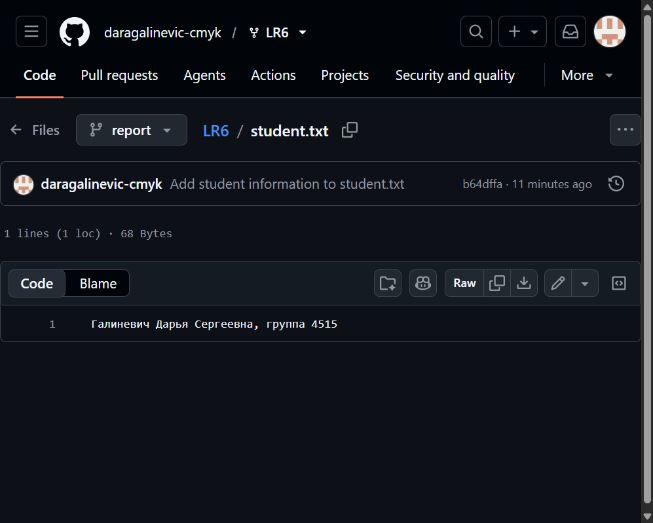
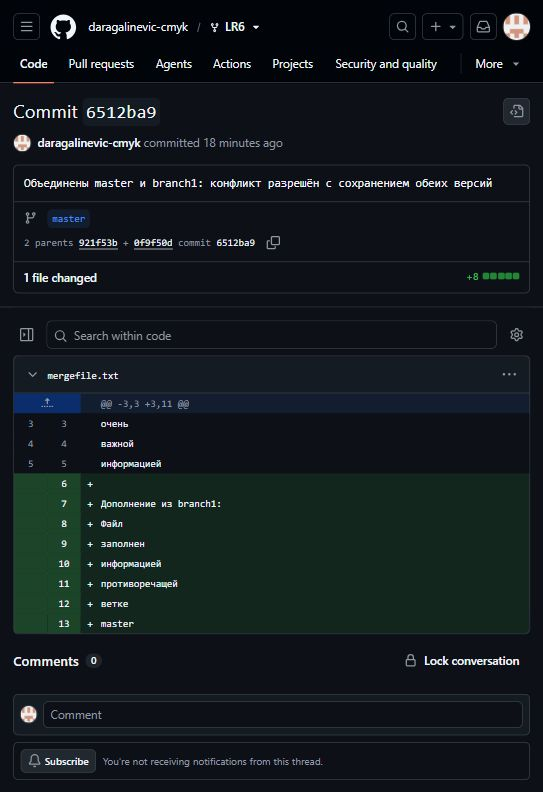
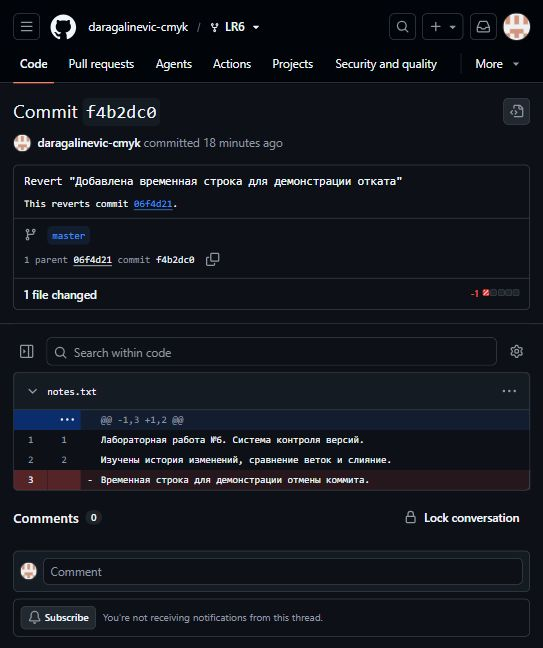
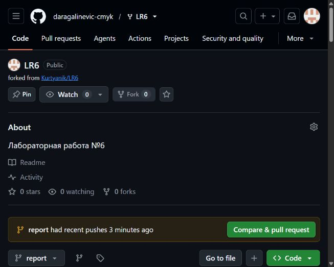
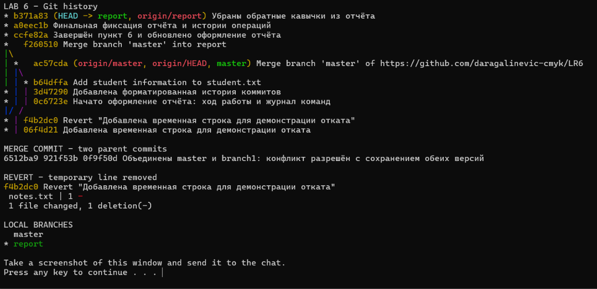

# Лабораторная работа №6. Система контроля версий

- **Выполнила:** Галиневич Дарья Сергеевна, группа 4515.
- **Преподаватель:** ассистент Т. Р. Мустафин.
- **Дисциплина:** Основы программирования.

## Цель работы

Освоить работу с локальным и удалённым репозиториями Git, сравнение и слияние веток, фиксацию и отмену изменений.

## Ход выполнения работы

### 1. Подготовка Git и GitHub

Создан [форк](https://github.com/daragalinevic-cmyk/LR6) исходного репозитория [Kurtyanik/LR6](https://github.com/Kurtyanik/LR6).

### 2. Клонирование репозитория

Форк клонирован на компьютер. Имя автора и почта настроены для локального репозитория. Ветка branch1 создана из origin/branch1.

```powershell
git clone https://github.com/daragalinevic-cmyk/LR6.git
cd LR6
git config user.name "4515 Галиневич Д.С."
git branch -a
git switch -c branch1 origin/branch1
```

### 3. Работа с удалённым репозиторием

Через GitHub добавлен [student.txt](student.txt) с именем студентки и номером группы. Файл появился в [коммите b64dffa](https://github.com/daragalinevic-cmyk/LR6/commit/b64dffa).



Рисунок 1 — Файл с данными студентки в ветке report.

Файл получен локально после операций с ветками и отмены коммита. Команда **git pull --no-rebase origin master** объединила историю удалённой и локальной веток **master** в [коммите ac57cda](https://github.com/daragalinevic-cmyk/LR6/commit/ac57cda). Затем обновления перенесены в **report**.

```powershell
git switch master
git pull --no-rebase origin master
git switch report
git merge master
```

### 4. Просмотр истории и сравнение веток

Просмотрена история обеих веток. Их общий коммит — [c08a654](https://github.com/daragalinevic-cmyk/LR6/commit/c08a654). Последние коммиты перед слиянием — [921f53b](https://github.com/daragalinevic-cmyk/LR6/commit/921f53b) в **master** и [0f9f50d](https://github.com/daragalinevic-cmyk/LR6/commit/0f9f50d) в **branch1**. Сравнение **git diff master branch1 -- mergefile.txt** показало, что ветки изменили один и тот же участок файла по-разному.

```powershell
git log --oneline master
git log --oneline branch1
git diff master branch1 -- mergefile.txt
```

| Ветка | Текст до слияния |
| --- | --- |
| master | Файл заполнен очень важной информацией |
| branch1 | Файл заполнен информацией, противоречащей ветке master |

### 5. Слияние веток и разрешение конфликта

В ветке **master** запущено слияние. Git остановил его из-за конфликта в **mergefile.txt**.

```powershell
git switch master
git merge branch1
```

В конфликтующем файле Git показал оба варианта между маркерами.

    <<<<<<< HEAD
    очень
    важной
    информацией
    =======
    информацией
    противоречащей
    ветке
    master
    >>>>>>> branch1

Маркеры удалены, оба варианта сохранены в [mergefile.txt](mergefile.txt). Текст из **branch1** вынесен в блок «Дополнение из branch1». Слияние завершено [коммитом 6512ba9](https://github.com/daragalinevic-cmyk/LR6/commit/6512ba9), у которого два родителя.

```powershell
git add mergefile.txt
git commit -m "Объединены master и branch1: конфликт разрешён с сохранением обеих версий"
```



Рисунок 2 — Два родительских коммита и результат разрешения конфликта.

### 6. Удаление побочной ветки

После слияния локальная ветка удалена. Её изменения вошли в **master**, а удалённая ветка **branch1** осталась на GitHub.

```powershell
git branch -d branch1
```

### 7. Создание последовательных коммитов

| Коммит | Изменение в notes.txt |
| --- | --- |
| [88c82fd](https://github.com/daragalinevic-cmyk/LR6/commit/88c82fd) | Создан файл с названием лабораторной работы. |
| [1d9c607](https://github.com/daragalinevic-cmyk/LR6/commit/1d9c607) | Добавлена строка об изученных операциях Git. |
| [06f4d21](https://github.com/daragalinevic-cmyk/LR6/commit/06f4d21) | Добавлена временная строка для демонстрации отмены. |

### 8. Отмена коммита

Выполнена отмена последнего изменения. Создан [коммит f4b2dc0](https://github.com/daragalinevic-cmyk/LR6/commit/f4b2dc0), который убрал временную строку из [notes.txt](notes.txt). В истории остались и добавление строки, и её отмена.

```powershell
git revert --no-edit HEAD
```



Рисунок 3 — Отменяющий коммит удалил одну строку.

### 9. Создание ветки для отчёта

Для отчёта создана ветка **report**. В ней размещены README, журнал команд и скриншоты. Ветки **master** и **report** отправлены на GitHub.

```powershell
git switch -c report
```



Рисунок 4 — Файлы отчёта в ветке report на GitHub.



Рисунок 5 — История коммитов, два родителя коммита слияния, результат отмены и список локальных веток после удаления branch1.

## Журнал команд

Ниже приведён журнал команд без вывода терминала. Отдельная копия журнала находится в [commands.log](commands.log).

```powershell
git clone https://github.com/daragalinevic-cmyk/LR6.git
cd LR6
git config user.name "4515 Галиневич Д.С."
git config user.email "daragalinevic@gmail.com"
git branch -a
git switch -c branch1 origin/branch1
git log --oneline branch1
git switch master
git log --oneline master
git diff master branch1 -- mergefile.txt
git merge branch1
git add mergefile.txt
git commit -m "Объединены master и branch1: конфликт разрешён с сохранением обеих версий"
git branch -d branch1
git add notes.txt
git commit -m "Добавлено описание лабораторной работы"
git add notes.txt
git commit -m "Дополнены сведения об изученных операциях Git"
git add notes.txt
git commit -m "Добавлена временная строка для демонстрации отката"
git revert --no-edit HEAD
git switch -c report
git add README.md commands.log screenshots/README.md
git commit -m "Начато оформление отчёта: ход работы и журнал команд"
git log --all --date=short --pretty=format:"%h | %ad | %an | %s"
git add README.md commands.log
git commit -m "Добавлена форматированная история коммитов"
git fetch origin
git switch master
git pull --no-rebase origin master
git switch report
git merge master
git add README.md commands.log screenshots/README.md
git commit -m "Завершён пункт 6 и обновлено оформление отчёта"
git log --all --date=short --pretty=format:"%h | %ad | %an | %s"
git add README.md commands.log
git commit -m "Финальная фиксация отчёта и истории операций"
git add README.md
git commit -m "Убраны обратные кавычки из отчёта"
git push --atomic origin master report
git --no-pager log --graph --oneline -10
git --no-pager show --no-patch --format="%h %p %s" 6512ba9
git --no-pager show --stat --oneline f4b2dc0
git branch --list
git log --all --date=short --pretty=format:"%h | %ad | %an | %s"
```

## История коммитов

Снимок истории перед обновлением оформления отчёта. В каждой строке указаны сокращённый хэш, дата, автор и сообщение коммита.

```
34de289 | 2026-11-05 | gardaris | Завершён отчёт со снимками и историей
7a889e5 | 2026-11-05 | gardaris | Добавлены снимки GitHub и консоли для отчёта
b371a83 | 2026-11-05 | 4515 Галиневич Д.С. | Убраны обратные кавычки из отчёта
a0eec1b | 2026-11-05 | 4515 Галиневич Д.С. | Финальная фиксация отчёта и истории операций
ccfe82a | 2026-11-05 | 4515 Галиневич Д.С. | Завершён пункт 6 и обновлено оформление отчёта
f260510 | 2026-11-05 | 4515 Галиневич Д.С. | Merge branch 'master' into report
ac57cda | 2026-11-05 | 4515 Галиневич Д.С. | Merge branch 'master' of https://github.com/daragalinevic-cmyk/LR6
b64dffa | 2026-11-05 | gardaris | Add student information to student.txt
3d47290 | 2026-11-05 | 4515 Галиневич Д.С. | Добавлена форматированная история коммитов
0c6723e | 2026-11-05 | 4515 Галиневич Д.С. | Начато оформление отчёта: ход работы и журнал команд
f4b2dc0 | 2026-11-05 | 4515 Галиневич Д.С. | Revert "Добавлена временная строка для демонстрации отката"
06f4d21 | 2026-11-05 | 4515 Галиневич Д.С. | Добавлена временная строка для демонстрации отката
1d9c607 | 2026-11-05 | 4515 Галиневич Д.С. | Дополнены сведения об изученных операциях Git
88c82fd | 2026-11-05 | 4515 Галиневич Д.С. | Добавлено описание лабораторной работы
6512ba9 | 2026-11-05 | 4515 Галиневич Д.С. | Объединены master и branch1: конфликт разрешён с сохранением обеих версий
921f53b | 2020-11-21 | Kurtyanik | Обновление информации
0f9f50d | 2020-11-21 | Kurtyanik | Заполнил файл
c08a654 | 2020-11-21 | Kurtyanik | Файл создан пустым
3c6e913 | 2020-11-21 | Kurtyanik | Initial commit
```

## Вывод

В ходе работы выполнены сравнение и слияние веток с ручным разрешением конфликта. На примере **notes.txt** показана отмена изменения с сохранением истории, а на примере **student.txt** — получение изменений с GitHub в локальный репозиторий.
