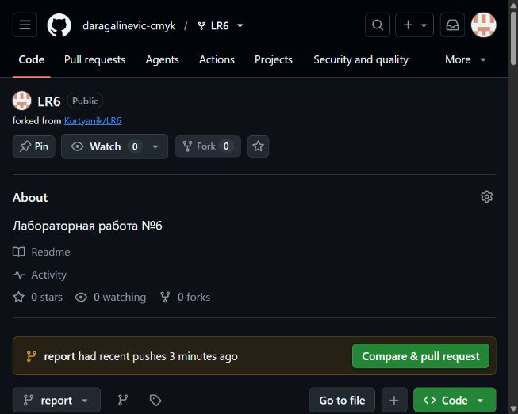
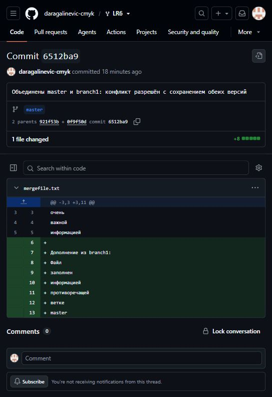
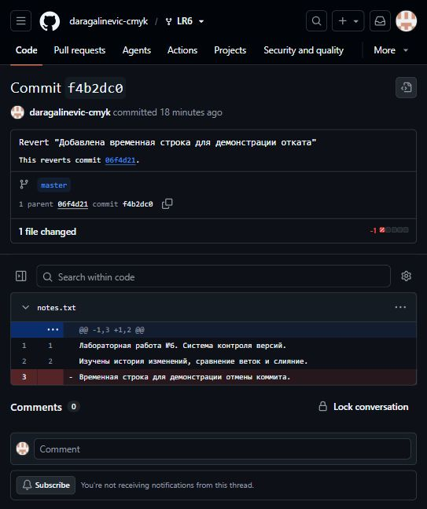
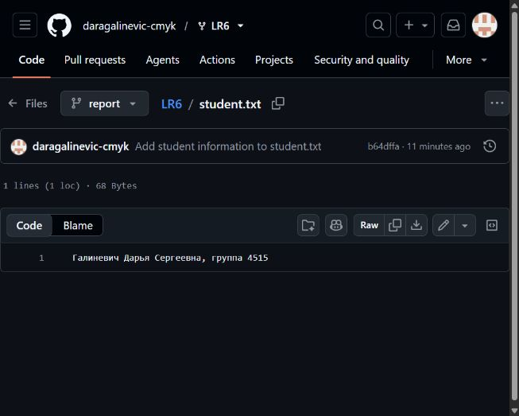
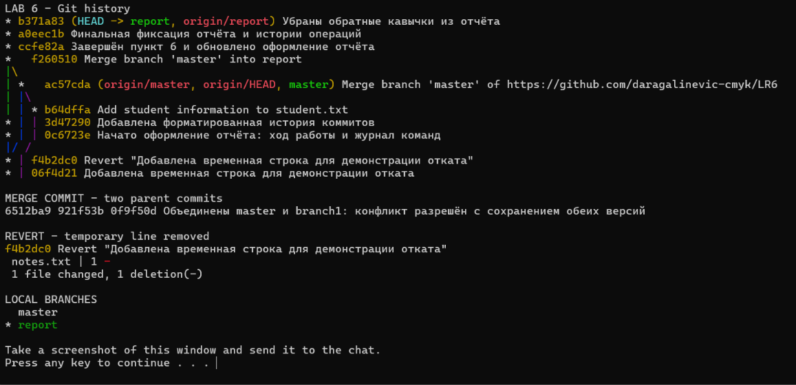

# Лабораторная работа №6. Система контроля версий

**Выполнила:** Галиневич Дарья Сергеевна, группа 4515.  
**Преподаватель:** ассистент Т. Р. Мустафин.  
**Дисциплина:** Основы программирования.

## Цель работы

Изучить базовые возможности системы контроля версий Git и приёмы работы с локальным и удалённым репозиторием.

## Подготовка репозитория

В аккаунте daragalinevic-cmyk создана копия репозитория Kurtyanik/LR6. Репозиторий клонирован на компьютер. В копии доступны ветки master и branch1. Для локального репозитория настроены имя автора 4515 Галиневич Д.С. и email daragalinevic@gmail.com. Настройки остальных репозиториев не изменялись.

Через интерфейс GitHub добавлен файл student.txt с текстом «Галиневич Дарья Сергеевна, группа 4515» (коммит b64dffa). В локальной ветке master выполнена команда git pull --no-rebase origin master: файл получен, удалённые и локальные изменения объединены. Затем изменения перенесены в ветку report командой git merge master.

## История веток и последние изменения

Истории просмотрены командами git log --oneline master и git log --oneline branch1. Общий коммит веток: c08a654 («Файл создан пустым»). В master последний исходный коммит — 921f53b («Обновление информации»); в branch1 — 0f9f50d («Заполнил файл»).

Команда git diff master branch1 -- mergefile.txt показала разные изменения одних и тех же строк. В master файл заполнен «очень важной информацией», в branch1 — «информацией, противоречащей ветке master».

## Слияние и разрешение конфликта

В ветке master выполнена команда git merge branch1. Git сообщил CONFLICT (content): Merge conflict in mergefile.txt. Конфликт возник, поскольку обе ветки изменили один участок файла.

Маркеры &lt;&lt;&lt;&lt;&lt;&lt;&lt;, ======= и >>>>>>> удалены. В итоговом файле сохранён текст из master, затем добавлен отдельный блок «Дополнение из branch1» с текстом второй ветки. Файл добавлен в индекс; слияние завершено коммитом 6512ba9. Успешно объединённая локальная ветка удалена командой git branch -d branch1. Удалённая ветка origin/branch1 сохранена.

## Последовательные изменения

Создан notes.txt с описанием лабораторной работы (коммит 88c82fd). Затем добавлены сведения об изученных операциях Git (коммит 1d9c607). Отдельным коммитом 06f4d21 добавлена временная строка для демонстрации отката.

## Откат коммита

Выполнена команда git revert --no-edit HEAD. Создан отменяющий коммит f4b2dc0: временная строка удалена, предыдущие изменения сохранены. Такой способ отменяет изменение без удаления коммитов из истории.

## Оформление отчёта

Создана ветка report. Отчёт размещён в README.md, команды без результатов выполнения — в [commands.log](commands.log).

Отчёт оформлен в Markdown. В отдельном PDF приведены титульный лист и ссылка на отчёт по предоставленному образцу. Снимки экрана размещены в отдельной папке screenshots и включены в отчёт ниже.

## Вывод

На практике выполнены просмотр истории и сравнение веток, слияние с разрешением конфликта, удаление объединённой локальной ветки, последовательные коммиты и отмена изменения через git revert. Создана отдельная ветка для отчёта. Файл, созданный через сайт GitHub, получен в локальный репозиторий. Ветки master и report отправлены в удалённый репозиторий GitHub.

## Снимки экрана

### Репозиторий и ветка отчёта

### Результат слияния

На странице коммита 6512ba9 видны два родительских коммита и объединённое содержимое mergefile.txt.

### Отмена коммита

Коммит f4b2dc0 отменяет добавление временной строки в notes.txt.

### Файл, добавленный через GitHub

### Консоль Git

В консоли показаны история ветки report, коммит слияния 6512ba9 с двумя родителями, отменяющий коммит f4b2dc0 и локальные ветки master и report. Локальная branch1 после слияния отсутствует.

## Форматированная история

История перед финальной фиксацией отчёта: сокращённый хэш, дата, автор, комментарий.

    7a889e5 | 2026-11-05 | gardaris | Добавлены снимки GitHub и консоли для отчёта
    b371a83 | 2026-11-05 | 4515 Галиневич Д.С. | Убраны обратные кавычки из отчёта
    a0eec1b | 2026-11-05 | 4515 Галиневич Д.С. | Финальная фиксация отчёта и истории операций
    ccfe82a | 2026-11-05 | 4515 Галиневич Д.С. | Завершён пункт 6 и обновлено оформление отчёта
    f260510 | 2026-11-05 | 4515 Галиневич Д.С. | Merge branch 'master' into report
    ac57cda | 2026-11-05 | 4515 Галиневич Д.С. | Merge branch 'master' of https://github.com/daragalinevic-cmyk/LR6
    b64dffa | 2026-11-05 | gardaris | Add student information to student.txt
    3d47290 | 2026-11-05 | 4515 Галиневич Д.С. | Добавлена форматированная история коммитов
    0c6723e | 2026-11-05 | 4515 Галиневич Д.С. | Начато оформление отчёта: ход работы и журнал команд
    f4b2dc0 | 2026-11-05 | 4515 Галиневич Д.С. | Revert "Добавлена временная строка для демонстрации отката"
    06f4d21 | 2026-11-05 | 4515 Галиневич Д.С. | Добавлена временная строка для демонстрации отката
    1d9c607 | 2026-11-05 | 4515 Галиневич Д.С. | Дополнены сведения об изученных операциях Git
    88c82fd | 2026-11-05 | 4515 Галиневич Д.С. | Добавлено описание лабораторной работы
    6512ba9 | 2026-11-05 | 4515 Галиневич Д.С. | Объединены master и branch1: конфликт разрешён с сохранением обеих версий
    921f53b | 2020-11-21 | Kurtyanik | Обновление информации
    0f9f50d | 2020-11-21 | Kurtyanik | Заполнил файл
    c08a654 | 2020-11-21 | Kurtyanik | Файл создан пустым
    3c6e913 | 2020-11-21 | Kurtyanik | Initial commit
